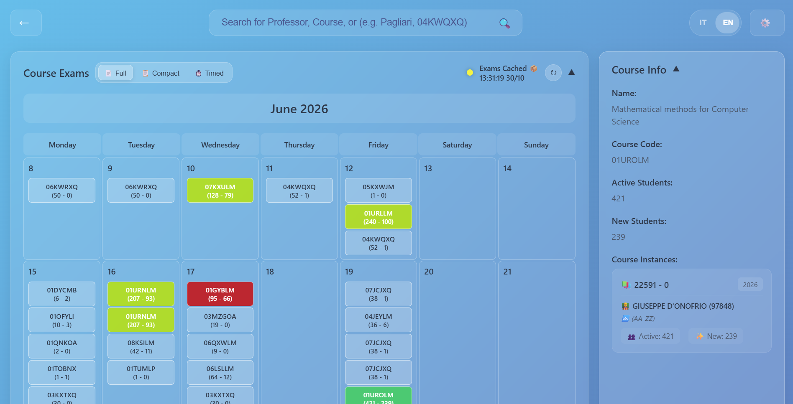
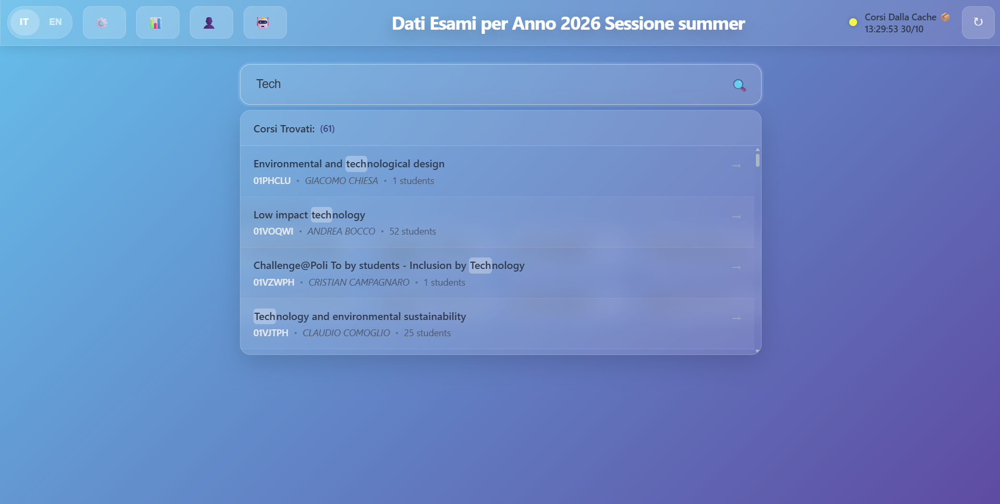
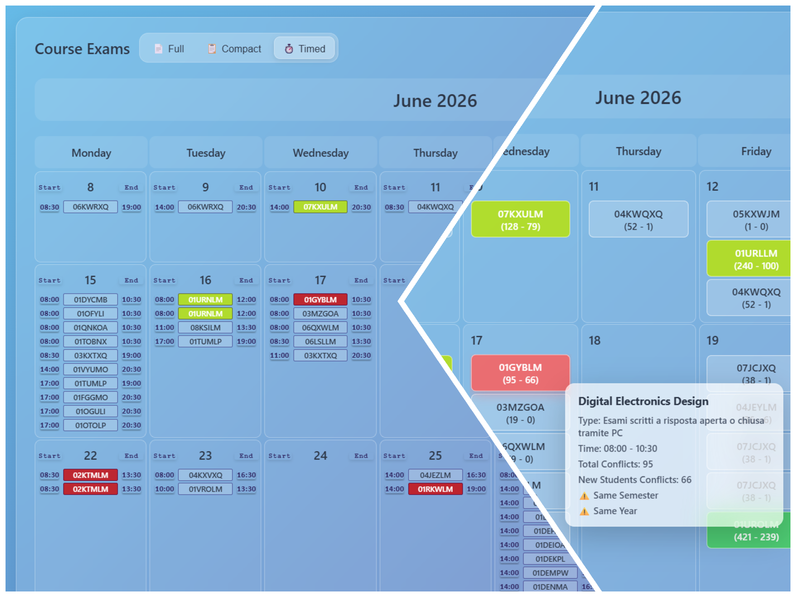
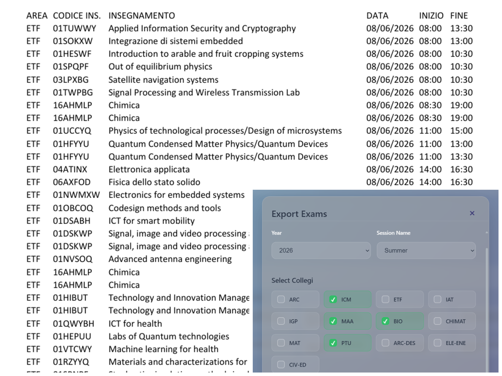

# University Exam Planner

> A React web application for exploring university courses, planning exam sessions, and visualizing exam conflicts.

The application provides a bilingual (English/Italian) interface backed by a remote API. Authenticated users can search courses, inspect exam schedules, configure sessions, synchronize backend data, export exam files, and run the integrated multi-phase agent workflow.

## Features

- **Course discovery** — Search by course name, code, or instructor with debounced results and highlighted matches.
- **Exam planning** — View exams in full, compact, or timed calendar layouts.
- **Conflict visualization** — Identify same-year and same-semester conflicts with color-coded calendar entries and detailed tooltips.
- **Course details** — Browse course metadata, instances, and active/new student counts.
- **Session management** — Select the academic year and session, reload caches or database data, and synchronize selected backend datasets.
- **Export** — Select collegi and export exam data for download.
- **Authentication and permissions** — Basic authentication with protected routes and role-based backend permissions.
- **Agent workflow** — Submit email text to one of three phases and follow streamed results and details.
- **Bilingual UI** — Switch between English and Italian without reloading the application.
- **GitHub Pages deployment** — Build and deploy automatically through GitHub Actions.

## Screenshots






## Routes

| Route | Description | Access |
| --- | --- | --- |
| `/login` | Sign in to the application | Public |
| `/` | Course search and exam planner dashboard | Authenticated |
| `/course/:courseId` | Course details and exam calendar | Authenticated |
| `/agent` | Multi-phase agent input and streamed output | Authenticated |

## Tech stack

- [React 18](https://react.dev/)
- [React Router 6](https://reactrouter.com/)
- [Axios](https://axios-http.com/)
- Create React App (`react-scripts`)
- CSS and the React Context API

## Getting started

### Prerequisites

- [Node.js](https://nodejs.org/) 18 or newer
- npm
- A running instance of the compatible backend API

### Install and run locally

```bash
git clone https://github.com/eml-eda/exam-planner-gui.git
cd exam-planner-gui
npm install
npm start
```

### Configure the backend

The API base URL is defined in [`src/utils/api_calls.js`](src/utils/api_calls.js). The repository defaults to the local development API:

```js
const baseUrl = "http://127.0.0.1:8000";
```

For the production deployment, switch it to the deployed backend URL shown in the source file. The frontend expects the backend to provide the endpoints listed in [Backend API](#backend-api).

## Backend API

The frontend centralizes API calls in [`src/utils/api_calls.js`](src/utils/api_calls.js). It uses these endpoints:

| Method | Endpoint | Purpose |
| --- | --- | --- |
| `GET` | `/courses` | Load courses |
| `GET` | `/config` | Load application/session configuration |
| `GET` | `/exams_appelli/{courseCode}` | Load exams and conflicts for a course |
| `GET` | `/last_sync_time/{key}` | Read synchronization status |
| `POST` | `/check_credentials` | Validate login credentials |
| `POST` | `/clear_exam_cache/{courseCode}` | Refresh one course's exam cache |
| `POST` | `/reload_caches` | Reload backend caches |
| `POST` | `/reload_database` | Reload data for a selected session |
| `POST` | `/sync_database` | Synchronize selected datasets |
| `POST` | `/export_exams` | Generate an exam export |
| `GET` | `/download/{filename}` | Download a generated export |
| `POST` | `/agent/run/stream` | Run an agent phase and stream results |

Public read operations are available to all users. Write, synchronization, and export operations require the corresponding backend permission.

### Roles and permissions

The backend defines three roles:

- **Admin** — Full read, write, synchronization, and export access.
- **Editor** — Read and write access, but no synchronization or export access.
- **Viewer** — Read-only access.

The authoritative endpoint/permission matrix and backend behavior are documented in [`doc/PROJECT_DOCUMENTATION.md`](doc/PROJECT_DOCUMENTATION.md).

## Deployment

Every push to `main` and every manually triggered workflow run starts [`.github/workflows/static.yml`](.github/workflows/static.yml). The workflow:

1. Installs dependencies with npm.
2. Builds the application.
3. Uploads the `build/` directory as a GitHub Pages artifact.
4. Deploys the artifact to GitHub Pages.

The app uses `HashRouter`, which keeps client-side routes compatible with static hosting.

## Project structure

```text
src/
├── components/   Reusable views, calendars, search, and modal dialogs
├── context/      Authentication, configuration, and language state
├── pages/        Login, home, course, and agent pages
└── utils/        API calls, course data, and recent-course helpers
public/           Static assets and the HTML entry point
doc/              Full project and backend documentation
```

## Documentation

For the complete architecture, state model, API contract, permission matrix, deployment details, and troubleshooting guide, see [`doc/PROJECT_DOCUMENTATION.md`](doc/PROJECT_DOCUMENTATION.md).